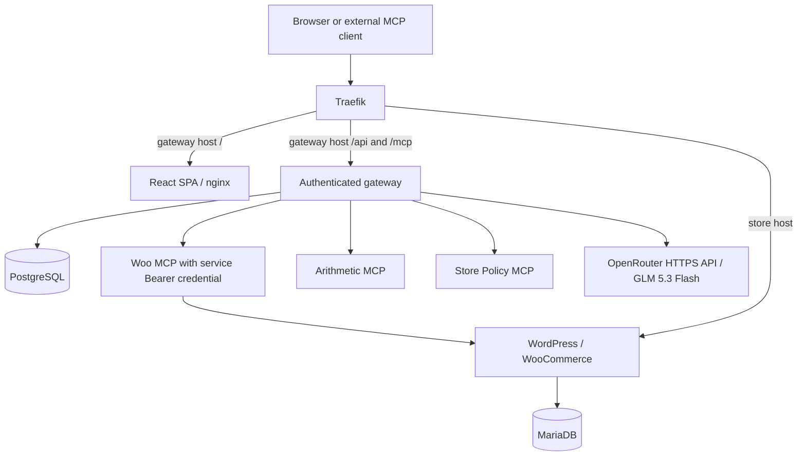

# MCP Gateway on Kubernetes

This repository is for the Urumi AI FDE internship assignment: run a WooCommerce store on Kubernetes, write its MCP server, aggregate at least three upstream MCP servers through a team gateway, and provide a React dashboard with a chat agent that uses the gateway as the logged-in user.

**Current state (16 November 2026):** The local core passed its live acceptance
flow on 14 November, followed by member dashboard key creation/revocation and a
repeatable external prompt check on 15 November. Product **30** and COD order **31**
are real demo data; User A chat and User B's MCP Inspector calls both composed
WooCommerce with Arithmetic. Revocation, disabled catalogs, upstream failure/recovery,
audit attribution, network isolation and PostgreSQL/gateway replacement were verified.
The original **382-test** acceptance baseline passed; the follow-up has **204 gateway** and **29 dashboard** tests plus **5 secret-setup** tests passing. The application now runs at
Helm revision **9** after the tested chat/readability update, OpenRouter **`z-ai/glm-5.3-flash`**, with original PVCs and Secrets.
**Video recording and form submission remain pending.** No real VPS, TLS or multi-store
deployment is claimed. See [dated acceptance and limits](docs/acceptance.md).

## Start here as a reviewer

Use **PowerShell 7** for the commands below. Clone with `git clone
https://github.com/DarshanKumarA/urumi-mcp-gateway.git`, then `Set-Location
urumi-mcp-gateway`. All paths below are relative to that directory. An OpenRouter
account/key with credit is required for LLM answers; this repository supplies no
credentials. Protocol tests and the other application tests use synthetic fixtures.

### Prerequisites and checks

Install Git, Docker Desktop with Linux containers/WSL2, kubectl, k3d, Helm 4,
PowerShell 7 and Python 3.13 from their official distributions. Node/npm is needed
for host dashboard tests and Inspector; image builds use the pinned container runtimes.
Check `git --version`, `docker version`, `kubectl version --client`, `k3d version`,
`helm version`, `$PSVersionTable.PSVersion`, `py -3.13 --version` and `node --version`.
Docker must report a running Linux server. Allow port 8080 for the local ingress;
6550 is the local Kubernetes API binding. Image/dependency downloads require Internet.

This is the tested Windows operator workflow, not a claim of a fresh-machine test.
Linux/macOS users need equivalent paths, hosts-file changes and secret provisioning;
the two store secret scripts require PowerShell 7. Keep enough RAM available for
Docker and the workload budgets. Do not run multiple fresh copies on a constrained laptop.

### If this is the existing project machine

Do not repeat fresh installation or recreate the cluster. Start Docker Desktop, then:

```powershell
k3d cluster list
# Only if urumi-local is stopped:
k3d cluster start urumi-local
kubectl config use-context k3d-urumi-local
kubectl --context k3d-urumi-local -n urumi get pods,pvc,ingress
helm list --kube-context k3d-urumi-local -n urumi
py -3.13 scripts/setup-platform-secrets.py check
```

Expected: six Deployments and two StatefulSets ready, three Bound claims, and store
and gateway Ingresses. Completed bootstrap/migration Jobs are normal. Open the two
URLs in the topology section. Sign in using the passwords chosen at setup; **there
is no default password**. Gateway admin `urumiadmin` and WordPress `urumi-admin` are
different accounts. Secret access is an operator recovery path, not a password reset.

### Fresh installation in the correct order

1. Create the cluster and hosts entries using steps 1–3 under **Reproduce the local
   deployment** below. Only create a cluster if `k3d cluster list` shows it is absent.
2. Select the context and create the namespace once:

   ```powershell
   kubectl config use-context k3d-urumi-local
   kubectl --context k3d-urumi-local create namespace urumi
   pwsh -File scripts/setup-store-secrets.ps1 -Mode Validate
   pwsh -File scripts/setup-store-secrets.ps1 -Mode Create
   ```

   The store helper generates database/auth secrets and prompts for the WordPress
   admin password. Save chosen passwords privately. It does not rotate existing data.
3. Install **only the store** first so WooCommerce can issue its REST credentials:

   ```powershell
   helm upgrade --install urumi charts/urumi --kube-context k3d-urumi-local -n urumi -f charts/urumi/values-local.yaml --set platform.enabled=false --set wooMcp.enabled=false --set auxiliaryMcp.arithmetic-mcp.enabled=false --set auxiliaryMcp.store-policy-mcp.enabled=false --wait=watcher --wait-for-jobs --timeout 15m
   kubectl --context k3d-urumi-local -n urumi get pods,jobs,pvc
   ```

   WordPress/MariaDB must be Ready and store bootstrap Complete. Never run these
   disables against an already accepted full stack.
4. Open `http://store.urumi.test:8080/wp-admin`, sign in as `urumi-admin` with your
   chosen store password. Go to WooCommerce → Settings → Advanced → REST API → Add
   key. Assign the service account, choose Read/Write and generate once. Privately
   enter the consumer key and secret into the masked helper prompts:

   ```powershell
   pwsh -File scripts/setup-woocommerce-rest-secret.ps1 -Mode Validate
   pwsh -File scripts/setup-woocommerce-rest-secret.ps1 -Mode Create
   py -3.13 scripts/setup-platform-secrets.py create
   py -3.13 scripts/setup-platform-secrets.py check
   ```

   The platform helper generates matching PostgreSQL password/URL and a separate
   Woo service token, then prompts for gateway admin credentials and OpenRouter key.
   It checks all existing contracts before creating missing objects, never replaces
   them, and is safe to rerun after correcting a partial setup. Never use tracing or
   terminal transcription while entering credentials. A shape check cannot prove an
   external API key is valid or funded.
5. Build/import all five images with step 6 below. Lint/render, then apply the **full
   local values** with step 8 below. The first fresh install preview uses
   `helm upgrade --install ... --dry-run=server`; the store release already exists
   after step 3. Do not pass `--reuse-values`, which could retain the temporary disables.
6. Wait for all eight workloads and gateway migration/bootstrap Jobs. Open the
   dashboard, sign in using your gateway credentials, refresh Servers and require
   three Connected upstreams/seven tools. Ask a read-only order question. An empty
   day is valid. Place a synthetic COD order to exercise nonempty totals.
7. Follow **Place a demo order**, **Connect User B**, and [the demo guide](docs/demo.md).
   Set up the Inspector dependencies before recording. The preserved order 31 is
   from 14 November 2026 and is not a current-day order on later dates.

### Run the automated checks without store mutations

Create each Python environment from its committed hash lock. Repeat for `gateway`,
`woo-mcp`, `arithmetic-mcp` and `store-policy-mcp`:

```powershell
py -3.13 -m venv apps/gateway/.venv
apps/gateway/.venv/Scripts/python -m pip install --require-hashes --only-binary=:all: -r apps/gateway/requirements.lock
Push-Location apps/gateway
try {
    $env:PYTHONPATH = 'src'
    .venv/Scripts/python -m unittest discover -s tests -q
} finally { Pop-Location }
```

For another app, replace both `apps/gateway` paths with its directory. Run the gateway
suite from its application directory because Alembic configuration is relative there.

```powershell
Push-Location apps/dashboard
try { npm ci --ignore-scripts; npm test; npm run build } finally { Pop-Location }
py -3.13 -m unittest discover -s tests/integration -p test_platform_secret_setup.py -q
helm lint charts/urumi -f charts/urumi/values-local.yaml
helm lint charts/urumi -f charts/urumi/values-prod.yaml
```

Full schema validation additionally needs `PyYAML` and `jsonschema` in your test
Python environment and a Kubernetes OpenAPI v2 JSON file; see
`tests/integration/validate_chart.py`. Application tests alone do not prove live
network isolation, checkout, persistence or external-client compatibility.

### When something fails

| Symptom | Check and next action |
| --- | --- |
| Local page will not open | Docker/cluster running, correct hosts entries, port 8080 and Ingress; do not reinstall the store |
| ImagePullBackOff or ErrImageNeverPull | Build and import the exact configured tag into urumi-local; inspect Pod events |
| Gateway not Ready | PostgreSQL Ready, migration/bootstrap Jobs Complete, exact Secret contracts; inspect events before changing anything |
| AI credit or authentication message | Verify the configured provider/model and protected key; check account credit. Do not paste the key into Chat |
| AI timeout or temporary outage | One bounded generation retry is automatic. If it still fails, wait and try a read-only question; record the troubleshooting code |
| A tool failed | Look at tool activity and Servers, refresh health; inspect the store before repeating any write |
| Orders missing | Check the store date/timezone, filters and pagination. Use 2026-11-14 to inspect preserved order 31 |
| External client gets 401 | B's own key must be active and B enabled; acceptance test users/keys are disabled/revoked intentionally |
| Email failed after checkout | Local SMTP is not configured; verify persisted order in Woo admin. This does not mean checkout failed |

Chat shows plain-language failures plus expandable troubleshooting codes. Server logs
record only a safe error code and completed-call count for chat failures, not prompts,
results or credentials. Never publish raw environment, Secret, or wire-level logs.

## Source of truth and project documents

The [original assignment DOCX](docs/source/urumi-mcp-gateway-assignment.docx) is authoritative. The [faithful Markdown transcription](docs/assignment.md) preserves its mandatory requirements, optional work, live demonstrations, deliverables, and evaluation expectations. Proposals elsewhere do not change the assignment.

| File | Purpose |
| --- | --- |
| [AGENTS.md](AGENTS.md) | Required learning, planning, change, review, and validation process |
| [.gitignore](.gitignore) | Exclude generated output and recognizable local secret files |
| [docs/requirements.md](docs/requirements.md) | Stable requirement IDs, verification plans, demo mapping, and optional scope |
| [docs/architecture.md](docs/architecture.md) | Assignment constraints, approved Architecture v1, and open implementation details |
| [docs/decisions.md](docs/decisions.md) | Individual decisions, alternatives, rationale, and explicitly superseded proposals |
| [docs/progress.md](docs/progress.md) | Milestone status, validation evidence, and review boundary |
| [docs/project-journey.md](docs/project-journey.md) | Chronological engineering story and learning for an interview walkthrough |
| [docs/threat-model.md](docs/threat-model.md) | Required threat analysis, required controls, and separate optional hardening |

## Final guides

- [Chat reliability and reviewer setup follow-up](docs/reliability-2026-11-15.md)
- [Interview reference PDF](docs/urumi-interview-reference.pdf) and [editable source](docs/interview-guide.md)

- [Live acceptance and evidence](docs/acceptance.md)
- [Demo script, Inspector setup and submission checklist](docs/demo.md)
- [Short system design and tradeoffs](docs/system-design.md)
- [Short threat model and security limits](docs/security-summary.md)
- [Production setup, upgrades and rollback](docs/production.md)

## Technology decisions and proposals

React is required for the dashboard. The assignment also mandates WordPress with WooCommerce, Kubernetes, Helm (not Kustomize), Streamable HTTP for the custom WooCommerce MCP server and supported upstreams, and Kubernetes Secrets.

Architecture v1 accepts one Python/FastAPI backend, the official Python MCP SDK, PostgreSQL for gateway state, MariaDB for the store, one application namespace, and one application Helm chart/release. The additional upstreams are arithmetic and store policy/reference servers with no external service dependencies. These are implementation choices, not technologies mandated by the assignment.

k3d with Docker Desktop is the validated local cluster platform (DEC-017). React/Vite, Python 3.13, MCP SDK 2.3.0 and PostgreSQL are implemented. OpenRouter is the active local LLM provider; the Gemini adapter remains available and is still the shared production default. See [architecture](docs/architecture.md) for pinned versions and the distinction between static, Docker and Kubernetes evidence. VPS k3s runtime remains unverified.

The mandatory core uses one store. Multi-store provisioning and other stand-out work are optional and have not been selected. VPS deployability using the same Helm charts and configuration changes is mandatory; actually demonstrating a VPS deployment is listed as stand-out work.

## Setup scope

The steps below reproduce the local packaging and deployment configuration. They do not reproduce existing database contents; the dated acceptance report records the observed local proof. A fresh-machine installation was not repeated in this completion run. Deliverable acceptance remains tracked as REQ-DEL-01 in [requirements](docs/requirements.md).

## Working process

Understand → plan → identify files → implement small change → review diff → validate → document → verify understanding. Follow [AGENTS.md](AGENTS.md) and the current user-authorized scope. Real credentials must never enter source or committed configuration.

## Final local topology and URLs



| Use | Local URL |
| --- | --- |
| Store | `http://store.urumi.test:8080` |
| Dashboard / same-origin API | `http://gateway.urumi.test:8080` / `/api` |
| External MCP | `http://gateway.urumi.test:8080/mcp` |

Both local hostnames resolve to `127.0.0.1` on the operator machine. Prefix paths
`/api` and `/mcp` route to gateway :8000, `/` to dashboard :8080; longest matching
prefix wins. Nginx supplies SPA refresh fallback. Store Ingress remains separate.
No upstream MCP or database has a public route.

## External Secret contracts

Local runtime update (16 November 2026): Helm revision 10 uses OpenRouter model
`z-ai/glm-5.3-flash` with gateway image `urumi-gateway:stage8.4-order-analysis`.
Add external Opaque Secret `urumi-openrouter` with exact key `api-key`, using the
same masked-input/in-memory submission process below. Only the local gateway
mounts it; the existing Gemini Secret is retained but not mounted locally.
Production retains its Gemini default. Direct provider smoke and two read-only
dashboard queries passed. Later live core acceptance is recorded in [acceptance.md](docs/acceptance.md); video/submission remain outstanding.

All are pre-created `Opaque` Secrets in namespace `urumi`; Helm creates none.
Check only name/type/exact key names, never dump data or decode values.

| Secret | Exact keys | Consumers |
| --- | --- | --- |
| `urumi-mariadb-root` | `root-password` | MariaDB |
| `urumi-store-db` | `password` | MariaDB, WordPress, store bootstrap |
| `urumi-wordpress-admin` | `admin-password` | Store bootstrap |
| `urumi-wordpress-auth` | `auth-key`, `secure-auth-key`, `logged-in-key`, `nonce-key`, `auth-salt`, `secure-auth-salt`, `logged-in-salt`, `nonce-salt` | WordPress, store bootstrap |
| `urumi-woocommerce-rest` | `consumer-key`, `consumer-secret` | Woo MCP only |
| `urumi-postgres-auth` | `password`, `database-url` | PostgreSQL gets password; gateway/migration/bootstrap get URL |
| `urumi-admin-bootstrap` | `username`, `password` | Gateway bootstrap Job only |
| `urumi-openrouter` | `api-key` | Gateway runtime, active local provider |
| `urumi-gemini` | `api-key` | Gateway only when Gemini selected; not needed for a fresh OpenRouter-only local setup |
| `urumi-woo-mcp-auth` | `token` | Woo MCP and gateway bootstrap Job only |

PostgreSQL password and URL must describe the same account. URL structure:
`postgresql+psycopg://<user>:<percent-encoded-password>@urumi-postgres.urumi.svc.cluster.local:5432/<database>`.
User/database default to `urumi_gateway`; bracketed text is explanatory, not a value.
Build the URL in protected operator memory with URL encoding. PostgreSQL uses
`POSTGRES_PASSWORD_FILE`; gateway uses `URUMI_DATABASE_URL_FILE`. No literal credential env values.

Stage 8.1 provisioning procedure: inspect contracts; preserve matching existing
objects; stop on conflicts; obtain values through separate masked prompts or a
protected Secret-manager interface; construct JSON in memory and submit through
redirected stdin with explicit context `k3d-urumi-local`, namespace `urumi` and
create-only semantics. Capture/suppress child output/error. No plaintext files,
credential CLI arguments, chat disclosure or automatic rotation/replacement.
Recheck identity/key names only. Use `py -3.13 scripts/setup-platform-secrets.py check` or `create` for the four
gateway/PostgreSQL/OpenRouter/service-token contracts. It preserves existing valid
objects, fails on conflicts and never applies/replaces Secrets. It targets only the
default local user/database/Service names. The reviewed
[REST helper](scripts/setup-woocommerce-rest-secret.ps1) remains specific to its
existing Secret. Review the concrete provisioning operation before entering real values.

Woo caller token: at least 256 random bits encoded as unpadded base64url, matching
`[A-Za-z0-9_-]{32,256}`. It is distinct from user API keys and Woo REST keys. Bootstrap
stores it server-side in PostgreSQL under the accepted credential model; DTOs/audits
exclude it. Secret rotation alone does not update an existing managed registration
or running Woo process; coordinated rotation needs review. No default admin password.

## Migration and bootstrap ordering

1. PostgreSQL starts on retained 2-GiB claim `data-urumi-postgres-0`.
2. Revisioned migration Job waits for DB and invokes Alembic `upgrade head` through
   its supported Python API. Migrations 0001–0003 remain unchanged.
3. Separate bootstrap Job waits for exact schema head, creates/verifies the initial
   administrator, then seeds `woocommerce`, `arithmetic`, `store_policy`.
4. Per-slug receipts own first creation only: preserve later edits, disabled state,
   changed credentials and deliberate removal. Only Woo gets a service credential.
5. Gateway init waits for schema plus bootstrap receipts. `/health/ready` repeats
   the read-only DB check. No migration, seed or password reset on server startup.

Jobs are ordinary resources, not hooks, allowing PostgreSQL in the same release.
Bounded waits (300s), deadlines (600s), `backoffLimit: 0` and wait-for-jobs make
failure explicit. Do not blindly repeat upgrades or automatically roll back.
Helm rollback does not rewind schema, DB or files. An audit left `started` means
interrupted/outcome unknown; there is no distributed exactly-once guarantee.

The separate existing store Job receives a release-revision-specific name. Its unchanged v3 code
validates ownership/settings, preserves installed users/passwords and business data,
and repeats the idempotent permalink hard-flush/fresh verification. It is not a new
installation or a strictly read-only shell run: rewrite persistence may be refreshed.
An owned-setting conflict must stop acceptance, not weaken validation or patch a marker.

## Images, probes and resources

| Workload | Local tag | CPU request / limit | Memory request / limit |
| --- | --- | --- | --- |
| Woo MCP | `urumi-woo-mcp:stage8.4-order-analysis` | 50m / 500m | 128Mi / 256Mi |
| Arithmetic | `urumi-arithmetic-mcp:stage6.1` | 25m / 250m | 64Mi / 128Mi |
| Store Policy | `urumi-store-policy-mcp:stage6.1` | 25m / 250m | 64Mi / 128Mi |
| Gateway | `urumi-gateway:stage8.4-order-analysis` | 100m / 1000m | 192Mi / 512Mi |
| Dashboard | `urumi-dashboard:stage8.4-order-analysis` | 25m / 250m | 32Mi / 128Mi |
| PostgreSQL | `postgres:18.6-bookworm` pinned below | 100m / 500m | 256Mi / 512Mi |
| Each gateway Job / init | gateway Stage 8 image | 100m / 500m | 128Mi / 256Mi |

Custom local images use `Never` pull policy and must be imported before deployment.
PostgreSQL Linux/amd64 manifest:
`sha256:6b38fe68f2c02cafffbbce7496f76d110d8a947c039bd22c067e9a43c2250240`.
[Official release](https://www.postgresql.org/docs/release/18.6/) and
[image contract](https://hub.docker.com/_/postgres) checked 26 October.
PG18 data lives at `/var/lib/postgresql/18/docker` under PVC mount `/var/lib/postgresql`.
PostgreSQL runs 999:999; custom apps run 10001:10001. New workloads omit API tokens,
drop capabilities, prohibit privilege escalation and use RuntimeDefault/read-only
root. PostgreSQL has writable data/socket/tmp; dashboard has only ephemeral `/tmp`.

Gateway startup/liveness use local TCP; readiness requires DB/schema/bootstrap, not
upstreams or the LLM provider. MCP probes stay TCP-local. Dashboard uses static HTTP for
readiness/liveness; PostgreSQL uses local `pg_isready`. Jobs use deadline/exit status.
Existing WordPress/MariaDB budgets/storage remain unchanged. New budgets are hypotheses.
Prefer about 4 GiB available Windows RAM; stop below approximately 3.5 GiB before
adding load. Do not lower accepted budgets to pass. PVC retention is not backup;
local PV reclaim remains Delete if its PVC is deleted. Node/disk-loss durability,
HA and full-stack capacity are unproven.

## LLM configuration and data flow

The local model is `z-ai/glm-5.3-flash`, accessed through OpenRouter's
`https://openrouter.ai/api/v1/chat/completions` endpoint. It requires an OpenRouter
API key and sufficient account credit. Availability, pricing and tool support can
change; check the [model page](https://openrouter.ai/z-ai/glm-5.3-flash) before use.
No key, credit or provider account is supplied by this repository.

The configuration source is `charts/urumi/values-local.yaml`:

```yaml
platform:
  gateway:
    image: {repository: urumi-gateway, tag: stage8.4-order-analysis, pullPolicy: Never}
    provider: openrouter
    model: z-ai/glm-5.3-flash
```

The chart renders `URUMI_CHAT_PROVIDER=openrouter`,
`URUMI_OPENROUTER_MODEL=z-ai/glm-5.3-flash` and
`URUMI_OPENROUTER_API_KEY_FILE=/run/secrets/openrouter/api-key`.
The file comes from `urumi-openrouter`; it is not a literal environment value.
Only the gateway receives the key. The existing Gemini Secret is retained in the
current cluster but is not mounted by the local gateway.

Chat follows: browser session identity → live namespaced tool catalog → model tool
request → shared InvocationService → committed audit START → upstream execution →
audit finalization → normalized result → model answer and safe UI trace. The model
does not contact WooCommerce directly. Requests use the already-pinned HTTP client;
timeout is 30 seconds per model attempt, with at most one additional model-generation
attempt for transient timeouts/transport failures or HTTP 429/500/502/503/504. Short
Retry-After hints are honored; longer hints stop immediately. Tool execution is never
automatically replayed. The overall chat deadline remains 180 seconds and the tool-round
limit is five. Redirects are disabled. OpenRouter provider fallback is disabled. Prompts, tool schemas and
sanitized operational results are sent to OpenRouter and its serving provider;
do not submit credentials or unnecessary personal data in Chat.

## Reproduce the local deployment

Run from the repository root with Docker Desktop in Linux mode, k3d, kubectl and
Helm installed. The validated environment uses Python 3.13, K3s v1.35.5+k3s1 and
a Helm version supporting `--wait=watcher`. Docker builds install the committed
hash-locked Python dependencies and dashboard npm lock. No host Python install
is needed just to build the images.

1. Check available host RAM: prefer about 4 GiB, stop below approximately 3.5 GiB
   before adding workloads. Do not reduce established resource requests to proceed.
2. Reuse `urumi-local` if it exists. Never recreate it to fix an application error.
   On a genuinely fresh machine only, create it with the recorded configuration:

   ```powershell
   k3d cluster create urumi-local --servers 1 --agents 0 --api-port 127.0.0.1:6550 --port "8080:80@loadbalancer" --port "8443:443@loadbalancer" --image rancher/k3s:v1.35.5-k3s1 --wait --timeout 5m
   ```

   For an existing stopped cluster, use `k3d cluster start urumi-local` instead.
   Select `k3d-urumi-local`; verify node Ready and MemoryPressure=False.
3. Add both local hostnames to the operator's hosts file as administrator:

   ```text
   127.0.0.1 store.urumi.test
   127.0.0.1 gateway.urumi.test
   ```

4. Ensure namespace `urumi` exists, then provision the external Secret contracts
   above through masked prompts/in-memory submission. Preserve valid existing
   Secrets. The committed store helper is `scripts/setup-store-secrets.ps1`; the
   Woo REST helper is `scripts/setup-woocommerce-rest-secret.ps1`. Each supports
   offline `Validate` and explicit `Create`/`Check`. Neither issues Woo REST keys.
   Run `py -3.13 scripts/setup-platform-secrets.py create` for the remaining local
   platform contracts. Do not substitute plaintext manifests or credential arguments.
5. On a fresh store, obtain the Woo Read/Write REST key from WooCommerce admin
   **after** WordPress is installed. For that first store-only installation, use
   the same chart with `platform.enabled=false`, `wooMcp.enabled=false`,
   `auxiliaryMcp.arithmetic-mcp.enabled=false` and
   `auxiliaryMcp.store-policy-mcp.enabled=false`. This breaks the fresh-store REST
   credential dependency; do not disable components on the existing accepted stack.
   Then create/check `urumi-woocommerce-rest`, provision the remaining contracts,
   and enable the complete stack through the normal local values.
6. Build the five local images (skip rebuilding when the reviewed images already
   exist and their identities have been verified):

   ```powershell
   docker build -t urumi-woo-mcp:stage8.4-order-analysis apps/woo-mcp
   docker build -t urumi-gateway:stage8.4-order-analysis apps/gateway
   docker build -t urumi-dashboard:stage8.4-order-analysis apps/dashboard
   docker build -t urumi-arithmetic-mcp:stage6.1 apps/arithmetic-mcp
   docker build -t urumi-store-policy-mcp:stage6.1 apps/store-policy-mcp
   k3d image import urumi-woo-mcp:stage8.4-order-analysis urumi-gateway:stage8.4-order-analysis urumi-dashboard:stage8.4-order-analysis urumi-arithmetic-mcp:stage6.1 urumi-store-policy-mcp:stage6.1 --cluster urumi-local
   ```

7. Lint/render before deployment. For an existing release also preview against the
   server and check store/PVC identity preservation; revision-named Jobs change on
   upgrades. Inspect output locally rather than committing generated manifests.

   ```powershell
   helm lint charts/urumi --values charts/urumi/values-local.yaml
   helm template urumi charts/urumi --namespace urumi --values charts/urumi/values-local.yaml
   helm upgrade urumi charts/urumi --namespace urumi --kube-context k3d-urumi-local --values charts/urumi/values-local.yaml --dry-run=server
   ```

8. Apply once after reviewing the preview and confirming Secrets/images/memory:

   ```powershell
   helm upgrade --install urumi charts/urumi --namespace urumi --kube-context k3d-urumi-local --values charts/urumi/values-local.yaml --wait=watcher --wait-for-jobs --timeout 15m
   kubectl --context k3d-urumi-local -n urumi get pods,jobs,pvc
   ```

   Require all workloads Ready, migration/bootstrap Jobs Complete, claims Bound
   and no OOM/restart loop. A registry EOF during the observed rollout was resolved
   by importing the exact pinned PostgreSQL image already cached in Docker, without
   changing its digest or repeatedly upgrading. Diagnose failures before retrying;
   do not delete claims or use automatic rollback.

## Verify and use

Log in to the dashboard with the administrator credentials supplied at bootstrap.
There is no default password. Refresh the Servers page and confirm WooCommerce,
Arithmetic and Store Policy are Connected. Start with the read-only prompt
`What orders came in today?`; check `woocommerce__list_orders` in tool activity and
the corresponding attributed Audit row.

For `What orders came in today, and what is their total and average order value?`,
expect `woocommerce__list_orders` then `arithmetic__sum_amounts` **when orders exist**.
The store uses Asia/Kolkata; an empty day has no average and should not trigger
arithmetic on an empty list. Use an explicit known order date for a nonempty
read-only replay. Order 31 belongs to 2026-11-14; a later day's empty result is correct.
For the recorded live today flow, intentionally place a new authorized demo COD order.

Each member creates their own gateway API key and configures an external MCP client
with only `http://gateway.urumi.test:8080/mcp` and that Bearer key. Never configure
upstream URLs or service/Woo REST credentials in an external client. A key is shown
once; revocation must reject its next request. Chat uses session identity instead.
Mutating tools can change real demo data; do not repeat a write after an ambiguous
response. Inspect state read-only first.

### Place a demo order

As User A, ask Chat to check a unique SKU, then create a named, priced product once.
Open its storefront URL, choose Add to cart → Cart → Proceed to Checkout, supply
synthetic demo contact/address details, select Cash on delivery and place the order.
Guest checkout needs no customer login. Verify the order in WooCommerce admin, then
ask A's chat for today's orders and their total/average; require actual Woo and
Arithmetic tool activity. WordPress uses `urumi-admin`; gateway uses `urumiadmin`.
Keep their passwords separate and off recordings. Email delivery is not configured.

### Connect User B

Invite a separate member from Team; redeem the private invitation and set a password.
As that member, use API Keys → Create API key and privately copy its one-time value.
Configure MCP Inspector with **Streamable HTTP**, the gateway endpoint above and
that member's Bearer key. No upstream URL or upstream service credential is needed.
The [demo guide](docs/demo.md#external-prompt-through-mcp-inspector) supplies a tested
masked-input command for discovery and a real model-selected two-upstream prompt.
It uses Inspector 2.15.0 and a separate OpenRouter prompt driver; Claude Code/Cursor
were not tested. Revoke the test key after the demo and verify its next call fails.

## Production and use

Same templates, `values-prod.yaml`: replace reserved registry/host/storage-class
values, provision TLS Secrets, configure DNS/Ingress, HTTPS Origin and Secure cookies.
No certificate is rendered. Production runtime/TLS are unverified. Internal Woo
OAuth/Host routing also needs VPS acceptance. Policies restrict only three MCP
listeners and PostgreSQL ingress; egress remains open for DNS/Woo/provider traffic.
K3s includes a [network policy controller](https://docs.k3s.io/networking/networking-services)
by default. Local acceptance observed allowed gateway traffic and a refused
non-gateway connection to Woo MCP; other CNIs/environments need their own validation.

For a fresh operator session: log in as initial admin, invite a member, generate each
user's own gateway API key, configure the external MCP endpoint with that Bearer
key, and use Chat with browser session identity through the shared audited path.
Never provide upstream service/Woo REST credentials to external clients. Existing
product 11/order 12 and product 16 remain; final acceptance added product 30/order 31.
Order 12 remains on hold. Setup alone does not authorize changing historical business data.
Use the [production runbook](docs/production.md) for actual target preparation and the
[demo checklist](docs/demo.md) for the remaining narrated recording/submission.

Optional scope: no multi-store, real VPS, OAuth, granular tool permissions, scaling or
rate-limit bonus was attempted. Targeted ingress policies and non-root custom apps
overlap optional hardening; their exact implementation/limits are listed in the
[security summary](docs/security-summary.md). No full hardening-bonus claim is made.

App contracts: [gateway](apps/gateway/README.md), [dashboard](apps/dashboard/README.md),
[Woo](apps/woo-mcp/README.md), [Arithmetic](apps/arithmetic-mcp/README.md),
[Policy](apps/store-policy-mcp/README.md).

### Product-ranking chat diagnosis

Order lists include compact product quantities so ranking questions do not require
a separate request per order. If `CHAT_CALL_LIMIT` appears, narrow the date/status
scope; completed tool activity remains visible. [Live diagnosis and verification](docs/order-analysis-2026-11-16.md)
records the reproduced failure, deployed correction and remaining limits.
