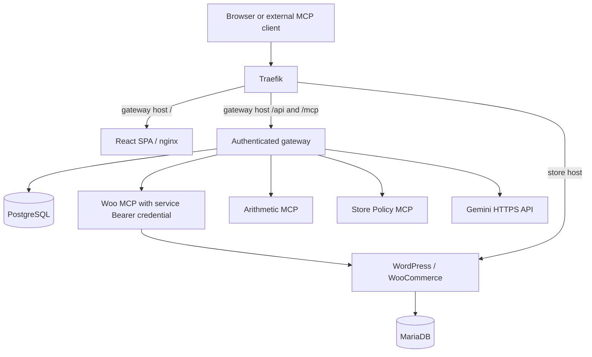

# MCP Gateway on Kubernetes

This repository is for the Urumi AI FDE internship assignment: run a WooCommerce store on Kubernetes, write its MCP server, aggregate at least three upstream MCP servers through a team gateway, and provide a React dashboard with a chat agent that uses the gateway as the logged-in user.

**Current state:** Stage 8.0 full-stack static integration is ready for review. Stage 7.1 is committed as `f793e62`; the existing local store was last validated at Helm revision 4. Kubernetes remained stopped during this stage. Revision 5 has NOT been applied. Full-stack capacity, NetworkPolicy enforcement, live Gemini composition, external-client demonstration and Definition of Done remain incomplete. See [progress](docs/progress.md) and [journey](docs/project-journey.md).

## Source of truth and project documents

The [original assignment DOCX](docs/source/urumi-mcp-gateway-assignment.docx) is authoritative. The [faithful Markdown transcription](docs/assignment.md) preserves its mandatory requirements, optional work, live demonstrations, deliverables, and evaluation expectations. Proposals elsewhere do not change the assignment.

| File | Purpose |
| --- | --- |
| [AGENTS.md](AGENTS.md) | Required learning, planning, change, review, and validation process |
| [.gitignore](.gitignore) | Exclude generated output and recognizable local secret files |
| [docs/requirements.md](docs/requirements.md) | Stable requirement IDs, verification plans, demo mapping, and optional scope |
| [docs/architecture.md](docs/architecture.md) | Assignment constraints, approved Architecture v1, and open implementation details |
| [docs/decisions.md](docs/decisions.md) | Individual decisions, alternatives, rationale, and explicitly superseded proposals |
| [docs/progress.md](docs/progress.md) | Milestone status, validation evidence, and review boundary |
| [docs/project-journey.md](docs/project-journey.md) | Chronological engineering story and learning for an interview walkthrough |
| [docs/threat-model.md](docs/threat-model.md) | Required threat analysis, required controls, and separate optional hardening |

## Technology decisions and proposals

React is required for the dashboard. The assignment also mandates WordPress with WooCommerce, Kubernetes, Helm (not Kustomize), Streamable HTTP for the custom WooCommerce MCP server and supported upstreams, and Kubernetes Secrets.

Architecture v1 accepts one Python/FastAPI backend, the official Python MCP SDK, PostgreSQL for gateway state, MariaDB for the store, one application namespace, and one application Helm chart/release. The additional upstreams are arithmetic and store policy/reference servers with no external service dependencies. These are implementation choices, not technologies mandated by the assignment.

k3d with Docker Desktop is the validated local cluster platform (DEC-017). React/Vite, Python 3.13, MCP SDK 2.3.0, PostgreSQL and Gemini integration are implemented. See [architecture](docs/architecture.md) for pinned versions and the distinction between static, Docker and Kubernetes evidence. VPS k3s runtime remains unverified.

The mandatory core uses one store. Multi-store provisioning and other stand-out work are optional and have not been selected. VPS deployability using the same Helm charts and configuration changes is mandatory; actually demonstrating a VPS deployment is listed as stand-out work.

## Setup and use instructions status

The following describes the reviewed packaging and proposed Stage 8.1 operations. It is not permission to deploy during Stage 8.0. Deliverable acceptance remains tracked as REQ-DEL-01 in [requirements](docs/requirements.md).

## Working process

Understand → plan → identify files → implement small change → review diff → validate → document → verify understanding. Follow [AGENTS.md](AGENTS.md) and stop at major milestones. Real credentials must never enter source or committed configuration. Stage 8.0 is static/offline only; no staging or commit.

## Final local topology and URLs

| Use | Local URL |
| --- | --- |
| Store | `http://store.urumi.test:8080` |
| Dashboard / same-origin API | `http://gateway.urumi.test:8080` / `/api` |
| External MCP | `http://gateway.urumi.test:8080/mcp` |

Both local hostnames resolve to `127.0.0.1` on the operator machine. Prefix paths
`/api` and `/mcp` route to gateway :8000, `/` to dashboard :8080; longest matching
prefix wins. Nginx supplies SPA refresh fallback. Store Ingress remains separate.
No upstream MCP or database has a public route.

## External Secret contracts

Local runtime update (27 October 2026): Helm revision 7 uses OpenRouter model
`z-ai/glm-5.3-flash` with gateway image `urumi-gateway:stage8.1-openrouter`.
Add external Opaque Secret `urumi-openrouter` with exact key `api-key`, using the
same masked-input/in-memory submission process below. Only the local gateway
mounts it; the existing Gemini Secret is retained but not mounted locally.
Production retains its Gemini default. Direct provider smoke and two read-only
dashboard queries passed; full Definition-of-Done acceptance remains incomplete.

All are pre-created `Opaque` Secrets in namespace `urumi`; Helm creates none.
Check only name/type/exact key names, never dump data or decode values.

| Secret | Exact keys | Consumers |
| --- | --- | --- |
| `urumi-mariadb-root` | `root-password` | MariaDB |
| `urumi-store-db` | `password` | MariaDB, WordPress, store bootstrap |
| `urumi-wordpress-admin` | `admin-password` | Store bootstrap |
| `urumi-wordpress-auth` | `auth-key`, `secure-auth-key`, `logged-in-key`, `nonce-key`, `auth-salt`, `secure-auth-salt`, `logged-in-salt`, `nonce-salt` | WordPress, store bootstrap |
| `urumi-woocommerce-rest` | `consumer-key`, `consumer-secret` | Woo MCP only |
| `urumi-postgres-auth` | `password`, `database-url` | PostgreSQL gets password; gateway/migration/bootstrap get URL |
| `urumi-admin-bootstrap` | `username`, `password` | Gateway bootstrap Job only |
| `urumi-gemini` | `api-key` | Gateway runtime only |
| `urumi-woo-mcp-auth` | `token` | Woo MCP and gateway bootstrap Job only |

PostgreSQL password and URL must describe the same account. URL structure:
`postgresql+psycopg://<user>:<percent-encoded-password>@urumi-postgres.urumi.svc.cluster.local:5432/<database>`.
User/database default to `urumi_gateway`; bracketed text is explanatory, not a value.
Build the URL in protected operator memory with URL encoding. PostgreSQL uses
`POSTGRES_PASSWORD_FILE`; gateway uses `URUMI_DATABASE_URL_FILE`. No literal credential env values.

Stage 8.1 provisioning procedure: inspect contracts; preserve matching existing
objects; stop on conflicts; obtain values through separate masked prompts or a
protected Secret-manager interface; construct JSON in memory and submit through
redirected stdin with explicit context `k3d-urumi-local`, namespace `urumi` and
create-only semantics. Capture/suppress child output/error. No plaintext files,
credential CLI arguments, chat disclosure or automatic rotation/replacement.
Recheck identity/key names only. No new helper was added; the reviewed
[REST helper](scripts/setup-woocommerce-rest-secret.ps1) remains specific to its
existing Secret. Review the concrete provisioning operation before entering real values.

Woo caller token: at least 256 random bits encoded as unpadded base64url, matching
`[A-Za-z0-9_-]{32,256}`. It is distinct from user API keys and Woo REST keys. Bootstrap
stores it server-side in PostgreSQL under the accepted credential model; DTOs/audits
exclude it. Secret rotation alone does not update an existing managed registration
or running Woo process; coordinated rotation needs review. No default admin password.

## Migration and bootstrap ordering

1. PostgreSQL starts on retained 2-GiB claim `data-urumi-postgres-0`.
2. Revisioned migration Job waits for DB and invokes Alembic `upgrade head` through
   its supported Python API. Migrations 0001–0003 remain unchanged.
3. Separate bootstrap Job waits for exact schema head, creates/verifies the initial
   administrator, then seeds `woocommerce`, `arithmetic`, `store_policy`.
4. Per-slug receipts own first creation only: preserve later edits, disabled state,
   changed credentials and deliberate removal. Only Woo gets a service credential.
5. Gateway init waits for schema plus bootstrap receipts. `/health/ready` repeats
   the read-only DB check. No migration, seed or password reset on server startup.

Jobs are ordinary resources, not hooks, allowing PostgreSQL in the same release.
Bounded waits (300s), deadlines (600s), `backoffLimit: 0` and wait-for-jobs make
failure explicit. Do not blindly repeat upgrades or automatically roll back.
Helm rollback does not rewind schema, DB or files. An audit left `started` means
interrupted/outcome unknown; there is no distributed exactly-once guarantee.

The separate existing store Job also receives an r5 name. Its unchanged v3 code
validates ownership/settings, preserves installed users/passwords and business data,
and repeats the idempotent permalink hard-flush/fresh verification. It is not a new
installation or a strictly read-only shell run: rewrite persistence may be refreshed.
An owned-setting conflict must stop acceptance, not weaken validation or patch a marker.

## Images, probes and resources

| Workload | Local tag | CPU request / limit | Memory request / limit |
| --- | --- | --- | --- |
| Woo MCP | `urumi-woo-mcp:stage8.0` | 50m / 500m | 128Mi / 256Mi |
| Arithmetic | `urumi-arithmetic-mcp:stage6.1` | 25m / 250m | 64Mi / 128Mi |
| Store Policy | `urumi-store-policy-mcp:stage6.1` | 25m / 250m | 64Mi / 128Mi |
| Gateway | `urumi-gateway:stage8.0` | 100m / 1000m | 192Mi / 512Mi |
| Dashboard | `urumi-dashboard:stage7.1` | 25m / 250m | 32Mi / 128Mi |
| PostgreSQL | `postgres:18.6-bookworm` pinned below | 100m / 500m | 256Mi / 512Mi |
| Each gateway Job / init | gateway Stage 8 image | 100m / 500m | 128Mi / 256Mi |

Custom local images use `Never` pull policy. Only Woo and gateway were rebuilt.
PostgreSQL Linux/amd64 manifest:
`sha256:6b38fe68f2c02cafffbbce7496f76d110d8a947c039bd22c067e9a43c2250240`.
[Official release](https://www.postgresql.org/docs/release/18.6/) and
[image contract](https://hub.docker.com/_/postgres) checked 26 October.
PG18 data lives at `/var/lib/postgresql/18/docker` under PVC mount `/var/lib/postgresql`.
PostgreSQL runs 999:999; custom apps run 10001:10001. New workloads omit API tokens,
drop capabilities, prohibit privilege escalation and use RuntimeDefault/read-only
root. PostgreSQL has writable data/socket/tmp; dashboard has only ephemeral `/tmp`.

Gateway startup/liveness use local TCP; readiness requires DB/schema/bootstrap, not
upstreams or Gemini. MCP probes stay TCP-local. Dashboard uses static HTTP for
readiness/liveness; PostgreSQL uses local `pg_isready`. Jobs use deadline/exit status.
Existing WordPress/MariaDB budgets/storage remain unchanged. New budgets are hypotheses.
Prefer about 4 GiB available Windows RAM; stop below approximately 3.5 GiB before
adding load. Do not lower accepted budgets to pass. PVC retention is not backup;
local PV reclaim remains Delete if its PVC is deleted. Node/disk-loss durability,
HA and full-stack capacity are unproven.

## Proposed Stage 8.1 sequence — not run

1. Gate RAM; start only the existing cluster when authorized. Verify node/system,
   revision 4, deterministic store/data/PVC baselines. Stop on drift.
2. Safely provision/check external Secret contracts; preserve existing objects.
3. Verify/import five reviewed custom image tags without rebuilding.
4. Server-side revision-5 dry-run against live revision 4; review additions, Woo
   caller-auth change and store `r4 → r5` ConfigMap/Job names.
5. One approved upgrade with watcher wait, wait-for-jobs, 15m timeout, no atomic
   rollback. Observe PostgreSQL → migration → bootstrap → gateway.
6. Verify original data/bindings, new PG claim, probes/restarts/OOM/memory and routes.
   Prove policy allowed/denied callers and missing/invalid Woo token rejection.
7. Verify registrations/auth/revocation/audits and read-only composition first.
   Live Gemini calls or more store mutations need their explicit acceptance scope.
8. Remove only diagnostic fixtures, retain application/storage/Secrets; stop for review.

## Production and use

Same templates, `values-prod.yaml`: replace reserved registry/host/storage-class
values, provision TLS Secrets, configure DNS/Ingress, HTTPS Origin and Secure cookies.
No certificate is rendered. Production runtime/TLS are unverified. Internal Woo
OAuth/Host routing also needs VPS acceptance. Policies restrict only three MCP
listeners and PostgreSQL ingress; egress remains open for DNS/Woo/Gemini.
K3s includes a [network policy controller](https://docs.k3s.io/networking/networking-services)
by default, but enforcement must be proven in Stage 8.1; other CNIs must support it.

After runtime approval: log in as initial admin, invite a member, generate each
user's own gateway API key, configure the external MCP endpoint with that Bearer
key, and use Chat with browser session identity through the shared audited path.
Never provide upstream service/Woo REST credentials to external clients. Existing
product 11/order 12 and live-test product 16 remain; no extra checkout or reversal
of the deliberate on-hold order is authorized by setup.

App contracts: [gateway](apps/gateway/README.md), [dashboard](apps/dashboard/README.md),
[Woo](apps/woo-mcp/README.md), [Arithmetic](apps/arithmetic-mcp/README.md),
[Policy](apps/store-policy-mcp/README.md).
