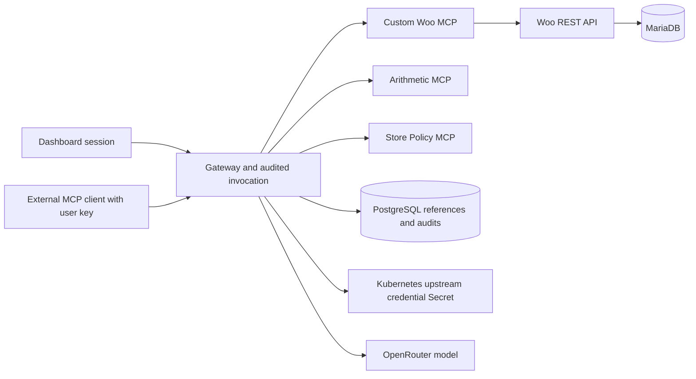

# System design and tradeoffs

One Helm release runs a single WooCommerce store and a team MCP gateway in namespace
`urumi`. The working local deployment is k3d/K3s with Traefik. React/nginx serves the
dashboard; FastAPI hosts session-authenticated management/chat and the API-key
authenticated `/mcp` endpoint. PostgreSQL persists gateway identities, registrations,
tools and audit records. WordPress/WooCommerce uses MariaDB and a persistent webroot.

## Request flow

The gateway is an MCP server to external clients and an MCP client to registered
upstreams. The official SDK supplies Streamable HTTP. Each operation owns its
upstream client/session, trading extra handshakes for straightforward cleanup,
timeouts and immediate configuration changes. The custom Woo adapter uses the
official WooCommerce REST API rather than executing store code. Internal Service
DNS handles connectivity; canonical Host/OAuth signing matches the WordPress origin.
It exposes bounded, PII-minimized product/order DTOs and never retries uncertain writes.

## Tools failures and audit

Tools are exposed as `<immutable_slug>__<original_tool_name>`. Routing verifies the
exact registered slug and authoritative cached original-name mapping; it does not
reconstruct the upstream name from a suffix. Overlong names get a deterministic
hash suffix; actual collisions are rejected. A real duplicate-name registration
and fixture routing tests verify the scheme.

Discovery refreshes enabled servers concurrently, with a five-second discovery
deadline and thirty-second invocation deadline by default. An unreachable server's
metadata is retained internally but excluded from the live catalog. Disabled servers
are likewise absent and stale calls are rejected against current configuration.
Dashboard health is observation-driven; it is refreshed by discovery/explicit refresh,
not a background heartbeat. Healthy peers remain callable during an upstream outage.

Both chat and external calls use `InvocationService`. It commits audit START before
dispatch, records resolved tool identity, and finalizes success/failure with duration.
Database failure before dispatch prevents execution. A crash or finalization failure
may leave an unknown outcome; there is no distributed transaction with WooCommerce
and no automatic retry. Known revoked/disabled keys are rejected before dispatch but
recorded as failed `KEY_REJECTED` audit events under their stored owner. Only cached
trusted tool metadata is used; initialization or unresolved names use `<authentication>`.
Unknown credentials are not assigned a guessed identity.

The dashboard model is OpenRouter `z-ai/glm-5.3-flash`. It receives the live tool
catalog, asks for calls, and receives sanitized operational results. The backend
executes those calls under the session user, never a model-supplied identity. Tool
activity is visible in the UI. The loop is bounded to five tool rounds and ten calls;
provider errors do not trigger automatic fallback or write replay. The revision-8
OpenRouter adapter permits one bounded transient model-generation retry; see
[the follow-up](reliability-2026-11-15.md).

## Deployment and production changes

All upstreams and databases are ClusterIP services. Gateway-labelled pods can reach
the three MCP listeners; the Woo listener also requires its separate service token.
The gateway and migration/bootstrap Jobs can reach PostgreSQL. These are targeted
ingress policies, not cluster-wide default-deny egress or complete SSRF protection.

The same chart renders local and production resources. Production changes are values:
registry image locations, domains/HTTPS origin, Secure cookies, TLS Secret references,
Ingress class, storage classes/capacities and operator-provisioned Secrets. See the
[production runbook](production.md). No real VPS/TLS deployment was performed.

Registry credential values live in one external Kubernetes Secret; PostgreSQL stores
opaque references. Gateway and migration/bootstrap Jobs use a narrowly scoped Role
and an explicitly projected rotating token. Every credential read verifies against
the API; an unavailable Secret store fails closed. This adds an API dependency and
latency to registry operations. Append-only entries favor recovery over automatic
garbage collection; see [security limits](security-summary.md).

Migration and bootstrap are explicit revisioned Jobs. The gateway waits for the schema
and bootstrap receipts; it never resets users or registrations at startup. Helm rollback
does not rewind database migrations or WordPress files. PVC retention protects routine
replacement, but it is not backup or protection from node/disk loss.

Arithmetic and Policy were chosen because they are deterministic and require no
external account. Multi-store provisioning, OAuth, per-tool permissions, scaling,
rate limits and production hosting are outside the implemented core. See
[local acceptance](acceptance.md) and the [short threat model](security-summary.md)
for verified behavior and remaining limitations.
